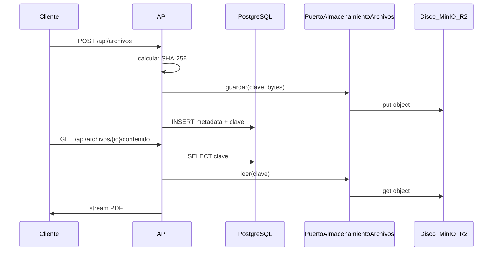

# Almacenamiento de objetos (disco / MinIO / Cloudflare R2)

**Versión:** 1.0  
**Relacionado:** [RECIBOS_FIRMA_ELECTRONICA.md](RECIBOS_FIRMA_ELECTRONICA.md) · [RECIBOS_CUMPLIMIENTO_PENDIENTE.md](RECIBOS_CUMPLIMIENTO_PENDIENTE.md) (CP-12)

## Arquitectura híbrida

| Capa | Responsabilidad |
|------|-----------------|
| **PostgreSQL** (`archivo_almacenado`) | Metadatos: nombre, MIME, tamaño, `hash_sha256`, `clave_almacenamiento` |
| **Object storage** | Bytes del PDF y demás archivos |
| **API** | Único punto de acceso autenticado; el cliente **nunca** recibe URL del bucket |



## Convención de claves

```
empresa/{empresaId}/archivos/{uuid}{extension}
```

Ejemplo: `empresa/1/archivos/a1b2c3d4-e5f6-7890-abcd-ef1234567890.pdf`

La clave es **independiente del proveedor**; al migrar de disco a R2 se conserva y no cambian `archivo_id` ni `recibo.hash_pdf`.

## Proveedores

| Valor `app.almacenamiento.proveedor` | Uso | Implementación |
|--------------------------------------|-----|----------------|
| `disco` (por defecto) | Desarrollo local sin Docker | `AdaptadorAlmacenamientoDisco` |
| `s3` | MinIO local o Cloudflare R2 | `AdaptadorAlmacenamientoS3` (API S3) |

MinIO y R2 comparten el **mismo adaptador**; solo cambian `endpoint`, credenciales y bucket.

## Configuración

### Desarrollo (disco)

```yaml
app:
  almacenamiento:
    proveedor: disco
    ruta-base: ./data/archivos
    tamano-maximo-mb: 10
```

### MinIO local (Docker)

Perfil Spring: `minio`

```yaml
app:
  almacenamiento:
    proveedor: s3
    tamano-maximo-mb: 10
    s3:
      endpoint: http://localhost:9000
      region: us-east-1
      bucket: rrhh-archivos
      access-key: rrhh_minio
      secret-key: rrhh_minio_secret
      path-style: true
```

Arranque:

```bash
docker compose up -d postgres minio minio-init
cd backend && mvn spring-boot:run -Dspring-boot.run.profiles=minio
```

Consola MinIO: http://localhost:9001 (mismas credenciales).

### Producción (Cloudflare R2)

```yaml
app:
  almacenamiento:
    proveedor: s3
    s3:
      endpoint: https://{ACCOUNT_ID}.r2.cloudflarestorage.com
      region: auto
      bucket: rrhh-archivos-prod
      access-key: ${S3_ACCESS_KEY}
      secret-key: ${S3_SECRET_KEY}
      path-style: false
```

Credenciales **solo** por variables de entorno; nunca en el repositorio.

## Sub-pasos de implementación (AS-01 … AS-08)

| ID | Título | Estado |
|----|--------|--------|
| AS-01 | Migración BD `clave_almacenamiento` | Implementado (Flyway V19) |
| AS-02 | Puerto `PuertoAlmacenamientoArchivos` | Implementado |
| AS-03 | `AdaptadorAlmacenamientoDisco` | Implementado |
| AS-04 | `AdaptadorAlmacenamientoS3` | Implementado |
| AS-05 | Refactor `ServicioAlmacenamiento` | Implementado |
| AS-06 | MinIO en `docker-compose.yml` | Implementado |
| AS-07 | Perfiles `application-minio.yml` | Implementado |
| AS-08 | Migración disco → R2 | Implementado (`perfil migracion`) |

## Migración disco → Cloudflare R2

### Cuándo

Al pasar a producción con R2, después de haber usado disco o MinIO en el mismo entorno.

### Procedimiento

1. Configurar credenciales R2 en variables de entorno.
2. Mantener el backend en `proveedor: disco` (origen).
3. Ejecutar migración one-shot:

```bash
cd backend
mvn spring-boot:run -Dspring-boot.run.profiles=migracion \
  -Dspring-boot.run.arguments=--migrar-almacenamiento=true
```

4. Verificar logs: cada archivo debe mostrar hash OK.
5. Cambiar `proveedor: s3` y endpoint R2 en producción.
6. Reiniciar backend.
7. Probar carga y firma de un recibo demo.

### Comportamiento del migrador

- Lista `archivo_almacenado` con `is_deleted = false`.
- Lee cada objeto desde el adaptador **disco** (ruta legacy soportada).
- Sube a S3/R2 con la **misma** `clave_almacenamiento`.
- Verifica que `hash_sha256` coincida.
- Idempotente: omite si la clave ya existe en destino.

### Ventana de mantenimiento

Recomendado: 5–15 minutos sin nuevas cargas de archivos, o ejecutar en horario de baja actividad.

### Backfill de claves legacy (PostgreSQL, solo si hay datos previos a V19)

Si existían archivos con `ruta_interna` absoluta antes de la migración, ejecutar en PostgreSQL:

```sql
UPDATE archivo_almacenado
SET clave_almacenamiento = 'empresa/' ||
    (regexp_match(clave_almacenamiento, '[\\/](\d+)[\\/][^\\/]+$'))[1] ||
    '/archivos/' ||
    (regexp_match(clave_almacenamiento, '([^\\/]+)$'))[1]
WHERE clave_almacenamiento NOT LIKE 'empresa/%'
  AND clave_almacenamiento ~ '[\\/](\d+)[\\/][^\\/]+$';
```

El adaptador disco también resuelve rutas legacy al leer si el backfill no se ejecutó.

## Reglas de seguridad

1. No exponer URLs presignadas del bucket al navegador del empleado (v1).
2. Todo acceso vía JWT + `/api/archivos/{id}/contenido` o `/api/recibos/{id}/pdf`.
3. Cifrado en tránsito: HTTPS obligatorio en producción.
4. Cifrado en reposo: responsabilidad del proveedor (MinIO/R2).
5. Eliminación de objetos: no expuesta hasta CP-02 (inmutabilidad legal).

## Transición invisible

| Capa | ¿Cambia al pasar a R2? |
|------|------------------------|
| API REST | No |
| Frontend / app móvil | No |
| `recibo.hash_pdf` / eventos firma | No |
| `application.yml` + credenciales | Sí |
| Script migración blobs | Sí (una vez) |

## Referencias de código

- `com.rrhh.saas.archivo.almacenamiento.PuertoAlmacenamientoArchivos`
- `com.rrhh.saas.archivo.servicio.ServicioAlmacenamiento`
- `com.rrhh.saas.archivo.servicio.ServicioMigracionAlmacenamiento`
- Migración: `V19__archivo_clave_almacenamiento.sql`
