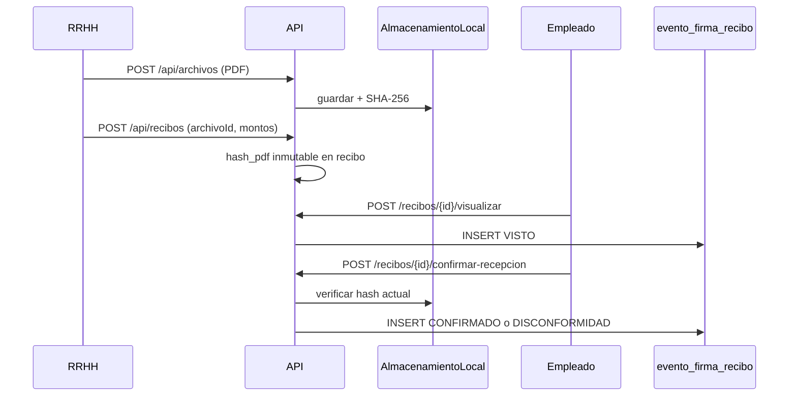

# Firma electrónica de recibos de sueldo

## Marco legal (Argentina)

| Norma | Relevancia |
|-------|------------|
| **Ley 25.506** (Firma Digital) | Define firma electrónica simple (PIN, contraseña, clic autenticado) y firma digital certificada |
| **Ley 27.802** (Modernización Laboral, vigente marzo 2026) | Elimina doble ejemplar en papel (Art. 140 LCT); la constancia de entrega puede documentarse con firma digital o electrónica |
| **Decreto 407/2026** (reglamentario) | Complementa procedimientos de documentación laboral digital |
| **Art. 140 LCT** | Conservación de recibos **10 años** |

### Qué implementa este sistema

- **Firma electrónica simple** para recibos: empleado autenticado (JWT) + confirmación explícita en portal/app.
- **No** firma digital certificada (PKI / proveedor acreditado): eso aplica al módulo de documentos con canvas/evidencia extendida.
- En juicio, con firma electrónica simple la **carga de prueba recae en el empleador** → por eso existe la tabla `evento_firma_recibo` (append-only).

## Flujo técnico

## Estados del recibo

| Estado | Significado |
|--------|-------------|
| `PENDIENTE` | Publicado, sin abrir |
| `VISTO` | El empleado abrió el PDF al menos una vez |
| `FIRMADO` | Confirmó recepción conforme |
| `DISCONFORMIDAD` | Firmó manifestando disconformidad (con comentario obligatorio) |

Los estados **solo avanzan**, nunca retroceden.

## Cadena de custodia (`evento_firma_recibo`)

Tabla **append-only** (sin UPDATE ni DELETE):

- `tipo`: `VISTO`, `CONFIRMADO`, `DISCONFORMIDAD`
- `timestamp_evento` (UTC)
- `direccion_ip`, `user_agent`, `sistema_operativo`
- `hash_pdf_en_firma` (debe coincidir con `recibo.hash_pdf`)
- `comentario` (obligatorio en disconformidad)

## Reglas críticas

1. `evento_firma_recibo` es append-only: no hay endpoints de modificación.
2. `recibo.hash_pdf` es **inmutable** desde la publicación.
3. El empleado puede firmar en **disconformidad** (derecho LCT).
4. Verificación de integridad: si el archivo en disco cambió → HTTP 409.

## Almacenamiento de archivos

Arquitectura híbrida: metadatos y hash en PostgreSQL (`archivo_almacenado.clave_almacenamiento`); bytes en object storage.

| Proveedor | Config `app.almacenamiento.proveedor` | Uso |
|-----------|--------------------------------------|-----|
| Disco local | `disco` (por defecto) | Desarrollo |
| MinIO / Cloudflare R2 | `s3` | Staging y producción (mismo adaptador S3) |

Documentación completa: [ALMACENAMIENTO_OBJETOS.md](ALMACENAMIENTO_OBJETOS.md).

## Matriz de cumplimiento

| Obligación | Estado | Notas |
|------------|--------|-------|
| Constancia digital de entrega (27.802) | Cumple | Confirmación autenticada + eventos |
| Firma electrónica simple (25.506) | Cumple | JWT + clic de confirmación |
| Disconformidad registrada (LCT) | Cumple | Tipo `DISCONFORMIDAD` + comentario |
| Cadena de custodia probatoria | Cumple | Expediente ZIP + comprobante JSON empleado |
| Conservación 10 años (Art. 140 LCT) | Cumple en código | [RETENCION_RECIBOS.md](RETENCION_RECIBOS.md); backups en prod |
| Inmutabilidad legal | Cumple | Servicio + trigger Flyway V23 (PostgreSQL) |
| Operación masiva de liquidación | Cumple | `POST /api/recibos/carga-masiva` + UI |
| Integración legajo | Cumple | Sección recibos en `/empleados/{id}/legajo` |
| Notificación puesta a disposición | Cumple | In-app + email opcional (`notificado_en`) |
| Acceso alternativo sin digital | Documentado | [ACCESO_ALTERNATIVO_RECIBOS.md](ACCESO_ALTERNATIVO_RECIBOS.md) |
| Firma digital certificada | Fuera de alcance | Módulo documentos / proveedor PKI futuro |

**Checklist reglamentario:** [DECRETO_407_2026_CHECKLIST.md](DECRETO_407_2026_CHECKLIST.md). Índice histórico: [RECIBOS_CUMPLIMIENTO_PENDIENTE.md](RECIBOS_CUMPLIMIENTO_PENDIENTE.md).

## API (resumen)

| Método | Ruta | Descripción |
|--------|------|-------------|
| POST | `/api/recibos` | RRHH publica recibo (`archivoId` obligatorio) |
| POST | `/api/recibos/carga-masiva` | Publicación masiva desde ZIP |
| POST | `/api/recibos/carga-masiva/analizar` | Vista previa de emparejamiento ZIP |
| GET | `/api/recibos/mis-recibos` | Lista del empleado |
| GET | `/api/recibos/{id}/pdf` | PDF autenticado |
| GET | `/api/recibos/{id}/expediente` | ZIP probatorio (manifest + eventos + PDF) |
| GET | `/api/recibos/{id}/comprobante` | JSON constancia de firma (empleado) |
| GET | `/api/recibos/{id}/versiones` | Historial de republicaciones |
| GET | `/api/recibos/alertas/seguimiento` | Métricas RRHH (pendientes, disconformidades) |
| GET | `/api/recibos/empleado/{empleadoId}` | Recibos del legajo |
| POST | `/api/recibos/{id}/republicar` | Nueva versión con PDF corregido |
| POST | `/api/recibos/{id}/reenviar-notificacion` | Reenvío in-app + email |
| POST | `/api/recibos/{id}/visualizar` | Registra evento VISTO |
| POST | `/api/recibos/{id}/confirmar-recepcion` | `{ tipo, comentario?, contrasena? }` |
| GET | `/api/recibos/{id}/eventos-firma` | Auditoría |

## Demo

1. Login RRHH: `rrhh@demo.local` / `Demo123!` → Recibos → cargar PDF.
2. Login empleado: `empleado@demo.local` → Mis recibos (web) o Recibos (móvil).
3. Abrir recibo → visualizar PDF → confirmar o disconformidad.

El seed demo publica un recibo del mes anterior con PDF almacenado localmente y hash SHA-256.
