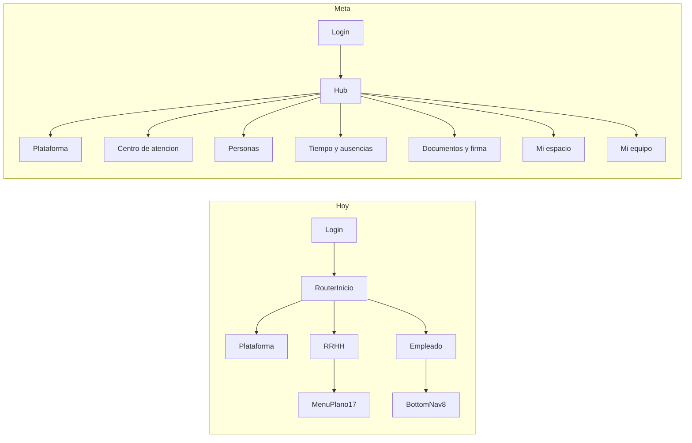
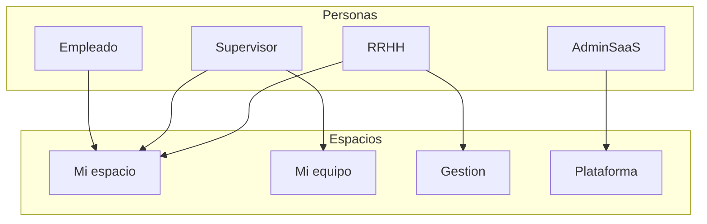

# Auditoría UX y rediseño de producto — Ligo

**Estado:** auditoría aprobada e implementación inicial en curso (tokens, UI kit, navegación, Centro de Atención, drawers piloto, Mi equipo, alineación móvil).
**Alcance auditado:** [`frontend/`](frontend/) (Angular 19, ~32 pantallas), [`app-movil/`](app-movil/) (Ionic 8 + Capacitor 7), tokens en [`frontend/src/_tokens.scss`](frontend/src/_tokens.scss) y menús en [`servicio-permisos.ts`](frontend/src/app/nucleo/servicios/servicio-permisos.ts).

**Decisión de stack (importante):** el producto es **Angular**, no React. La etapa de implementación se hará sobre Angular 19 con un kit de componentes propio. “Recomendaciones React” se reinterpretan como patrones de arquitectura de componentes equivalentes (standalone, signals, design tokens) aplicables a Angular.

**Principio de marca:** *Conectar personas y empresas* — cercana, moderna, simple, humana, confiable. Nunca burocrática.

---

## Diagnóstico ejecutivo

Ligo ya tiene identidad visual propia (menta + coral, Plus Jakarta Sans, Lucide) y una separación razonable de tres shells (Plataforma / RRHH / Empleado). Eso es una base sólida.

El producto **no se siente premium** hoy porque:

1. El menú RRHH es una lista plana de hasta **17 ítems** sin agrupación.
2. Las pantallas RRHH siguen el patrón repetido **tabla densa + formulario inline** (CRUD de backoffice, no producto SaaS moderno).
3. No hay componentes UI reales: solo clases CSS globales (~2000 líneas en `styles.scss`) → inconsistencia inevitable.
4. Falta infraestructura de productividad: Command Palette, breadcrumbs, búsqueda global, favoritos.
5. No existe **portal de supervisor** (quien aprueba cae en el shell RRHH completo).
6. El portal web empleado satura la bottom-nav (hasta 8 tabs); la app móvil ya resolvió mejor esto con “Más” (5 tabs).
7. Estados crudos al usuario (`EN_REVISION`, `FIRMADO`), textos legales largos inline, y **sin cerrar sesión visible** en el portal web empleado.

Veredicto: funcionalidad rica, **experiencia de producto incompleta**. El salto a nivel internacional es de arquitectura de información + design system + patrones de interacción, no de “más features”.

---

# 1. Problemas encontrados

Formato: **descripción → impacto → prioridad (P0/P1/P2) → solución**.

### Navegación e IA

| ID | Problema | Impacto | Pri | Solución |
|----|----------|---------|-----|----------|
| N1 | Sidebar RRHH plana (~17 ítems) sin secciones | Carga cognitiva alta; módulos se pierden | P0 | Sidebar agrupada en 5 secciones (ver §6) |
| N2 | Bottom-nav web empleado hasta 8 ítems; labels 0.625rem | Ilegible en móvil; confusión Avisos vs Alertas | P0 | 5 tabs: Inicio, Pedidos, Documentos, Más, Perfil (como app móvil) |
| N3 | Sin portal/dashboard supervisor | Aprobadores ven backoffice completo | P0 | Nuevo rol UI “Mi equipo” con bandeja de aprobaciones |
| N4 | Sin Command Palette / búsqueda global | Muchos clics para tareas frecuentes | P0 | Ctrl/Cmd+K: ir a, buscar persona, acciones rápidas |
| N5 | Sin breadcrumbs | Orientación pobre en subrutas (fichajes/zonas, legajo) | P1 | Migas contextuales bajo header de página |
| N6 | Config (fichajes, certificados IA) fuera del menú | Features “escondidas” | P1 | Agrupar bajo Configuración con subnav |
| N7 | Tres shells visualmente desalineados (logo vs “Tu espacio”) | Marca fragmentada | P1 | Misma marca Ligo + contexto (“Tu espacio” como subtítulo) |
| N8 | Portal empleado: logout en TS pero no en HTML | Bloqueo operativo | P0 | Logout en Perfil + menú cuenta del header |

### Patrones de pantalla

| ID | Problema | Impacto | Pri | Solución |
|----|----------|---------|-----|----------|
| P1 | Formulario “Nuevo…” inline empuja la tabla (empleados, activos, ausencias, etc.) | Scroll, pérdida de contexto | P0 | Crear/editar en **Drawer** o Dialog; listado siempre visible |
| P2 | Tablas de 8–9 columnas (recibos, certificados, novedades) | Escaneo imposible | P0 | Columnas esenciales + panel de detalle; resto en drawer |
| P3 | Acciones por fila sobrecargadas (3–4 botones) | Errores y ruido | P0 | 1 CTA primaria + menú “…” (acciones secundarias) |
| P4 | Vacaciones RRHH con **6 tabs** + detalle debajo de tabla | Pantalla más compleja del producto | P0 | Dividir: Bandeja / Calendario / Políticas (config) |
| P5 | Certificados: modales encadenados + ID técnico + JSON GCP en UI | Intimidante, poco humano | P0 | Wizard de revisión; config IA solo en Ajustes con roles |
| P6 | Asignación de documentos = checklist de todos los empleados | No escala | P1 | Combobox multi-select + filtros por área/sector |
| P7 | Legajo = scroll infinito sin tabs | Difícil encontrar info | P0 | Tabs: Datos / Onboarding / Documentos / Recibos / Activos |
| P8 | Empty states pobres en RRHH (`—` en celda) vs buenos en portal | Inconsistencia; sensación “incompleto” | P1 | Componente `EstadoVacio` unificado con CTA |
| P9 | Estados enum crudos visibles | Lenguaje de sistema, no humano | P0 | Diccionario de etiquetas (“En revisión”, “Firmado”) |
| P10 | Textos legales LCT / firma largos inline | Fricción en firma de recibos | P1 | Resumen + “Ver condiciones” expandible |
| P11 | Dashboard RRHH: KPI vacaciones = total no pendientes; datos pedidos y no mostrados; KPIs sin filtrar por permiso | Desconfianza en métricas | P0 | Solo métricas accionables + gated por permiso |
| P12 | Widget recibos domina el dashboard | Inicio sesgado a un módulo | P1 | “Atención hoy” unificada (aprobaciones, firmas, alertas) |
| P13 | Login sin recuperar contraseña / SSO | Fricción enterprise | P1 | “Olvidé mi contraseña”; SSO como fase 2 |
| P14 | Perfil empleado solo lectura, sin avatar | Poco humano | P2 | Foto + datos editables permitidos |
| P15 | RRHH sidebar fija: mala experiencia tablet/móvil | Admin inutilizable en móvil | P1 | Sidebar colapsable + app RRHH ya existente alineada |
| P16 | Design system solo CSS classes, sin átomos Angular | Drift visual (colores hardcodeados en firma, etc.) | P0 | Librería `ui/` de componentes + tokens ampliados |
| P17 | Sin dark mode preparado | Gap vs productos de referencia | P2 | Tokens `--color-*` duales desde el día 1 |
| P18 | App móvil y web portal con IA distinta (5 vs 8 tabs) | Dos productos mentales | P0 | Unificar IA: web adopta patrón “Más” de móvil |
| P19 | Ausencias / Certificados / Solicitudes solapados | Usuario no sabe dónde cargar un médico | P1 | Flujo único “Avisar ausencia” con tipos |
| P20 | Novedades (liquidación) en menú principal | Término opaco para no-liquidadores | P1 | Renombrar “Liquidación” y mover a sección Tiempo/Pagos |

---

# 2. Priorización

### P0 — Bloqueantes de percepción premium (hacer primero)
N1, N2, N3, N4, N8, P1–P5, P7, P9, P11, P16, P18

### P1 — Alto valor en el primer rediseño
N5–N7, P6, P8, P10, P12–P13, P15, P19–P20

### P2 — Refinamiento
P14, P17, microinteracciones, charts avanzados, favoritos persistentes

---

# 3. Quick wins (1–2 sprints, bajo riesgo)

1. **Etiquetas humanas** de estados (mapa enum → castellano).
2. **Cerrar sesión** visible en portal empleado (Perfil).
3. **Agrupar sidebar RRHH** sin cambiar rutas (solo estructura de menú).
4. **Bottom-nav web → 5 ítems** + página “Más” (copiar app móvil).
5. **Empty states** unificados en listados RRHH.
6. **Corregir KPIs** del panel (pendientes reales + permisos).
7. **Menú “…”** en filas de acciones densas (recibos, solicitudes).
8. **Ocultar IDs técnicos** y hashes en listados (detalle solo).
9. **Textos legales** colapsables en firma.
10. **Focus/hover** consistentes en botones existentes (tokens).

---

# 4. Mejoras de alto impacto

1. **Centro de Atención** como home RRHH/supervisor (bandeja unificada de pendientes).
2. **Command Palette** (Ctrl+K).
3. **Drawers** para crear/editar/detalle (eliminar formularios inline).
4. **Legajo tabulado** como hub de la persona.
5. **Flujo “Pedir tiempo libre”** unificado (vacaciones / ausencia / certificado).
6. **Design System como componentes Angular** (no solo CSS).
7. **Portal Supervisor** (“Mi equipo”).
8. **Unificar web + móvil** en misma IA y mismos tokens.

---

# 5. Nuevo Design System — “Ligo UI”

Inspiración (no copia): Linear (densidad y foco), Notion (calma y tipografía), Slack (humanidad), Mercado Pago/Ualá (claridad LATAM), Rippling (estructura HR).

### 5.1 Principios
- **Una acción primaria por vista.**
- **Espacio > bordes:** menos cajas, más ritmo.
- **Color con propósito:** el menta guía; el coral solo alerta/acento humano.
- **Lenguaje humano:** nunca códigos de sistema.
- **Mismo Ligo en web, portal y móvil.**

### 5.2 Paleta (evolución de tokens actuales)

Mantener el ADN menta/coral; completar escala semántica.

**Primarios**
- `primario-500` `#2BB89A` · hover `primario-600` `#229E84` · pressed `primario-700` `#1B8670`
- `primario-50` `#ECFAF6` · `primario-100` `#D5F4EB` · borde `primario-200` `#A7E8D6`

**Secundarios / marca profunda**
- `secundario-700` `#0D7377` · `secundario-800` `#0A5C5F` · suave `#E6F4F4`

**Acento humano (coral)** — CTAs emocionales, badges “nuevo”, avatares fallback
- `acento-400` `#F28B82` · hover `#E57268` · suave `#FEF1F0`

**Neutrales**
- Fondo app `#F5F8F7` · Superficie `#FFFFFF` · Superficie 2 `#EEF3F1`
- Texto 1 `#14201C` · Texto 2 `#5B6B66` · Texto 3 `#8A9A94`
- Borde `#E2EAE7` · Borde fuerte `#C5D4CF`

**Semánticos**
- Éxito: fondo `#E8F7F1` · texto `#0F6B52` · icono `#1A9A74`
- Warning: fondo `#FFF6E8` · texto `#9A5B00` · borde `#F5D9A8`
- Error: fondo `#FEF1F1` · texto `#B42318` · borde `#F5C4C0`
- Info: fondo `#EAF3FF` · texto `#175CD3` · borde `#B2D0FF`

**Estados de control**
- Hover: oscurecer 8% o fondo `primario-50`
- Focus: ring `0 0 0 3px` `primario-200` + outline `primario-500`
- Disabled: opacity 0.45 + `pointer-events: none` + texto `texto-3`
- Selected: fondo `primario-50` + borde `primario-200` + texto `secundario-800`

**Dark mode (preparado, no activado aún)**
- Fondo `#0E1513` · Superficie `#16201D` · Superficie 2 `#1E2A26`
- Texto 1 `#E8F0ED` · Texto 2 `#9AADA6` · Borde `#2A3A35`
- Primario se aclara a `#3DCFB0` para contraste WCAG

Documentar en `_tokens.scss` con `:root` + `[data-tema="oscuro"]`.

### 5.3 Tipografía
- **Familia:** Plus Jakarta Sans (ya en uso) — mantener.
- **Escala:** Display 32/40 · H1 24/32 · H2 20/28 · H3 16/24 · Body 14/22 · Body sm 13/20 · Caption 12/16 · Overline 11/14 uppercase tracking.
- **Pesos:** 400 body · 500 UI · 600 títulos · 700 sparingly (marca/hero).
- **Regla:** máximo un Display por viewport; dashboards empiezan en H1.

### 5.4 Espaciado y grid
- Base **4px**, preferir múltiplos de **8** para layout.
- Escala: 4, 8, 12, 16, 20, 24, 32, 40, 48, 64.
- Contenido RRHH: max **1280px** (hoy 1120 — subir levemente).
- Portal empleado: max **720px** (mantener).
- Sidebar: **240px** expandida / **64px** icon-rail colapsada.
- Padding de página: 24 desktop / 16 mobile.

### 5.5 Radius, sombras, elevación
- Radius: sm 6 · md 10 · lg 14 · xl 20 · full pill solo en badges/avatars.
- Elevación: 0 flat · 1 card `sombra-sm` · 2 dropdown `sombra-md` · 3 modal `sombra-lg` · 4 toast.
- **Sin** glow neón ni multi-shadow pesados.

### 5.6 Componentes a construir (kit Angular `ui/`)

Button, IconButton, Card (solo si hay interacción), Badge, Avatar, Input, Textarea, Select, Combobox, Table (con density compact/comfortable), Tabs, Dialog, Drawer, Toast, Alert, Calendar, DatePicker, Search, CommandPalette, Navbar, Sidebar, Breadcrumb, Pagination, Stepper, Progress, Timeline, Accordion, Skeleton, Loader, EmptyState, ErrorState, Chart wrappers, WidgetKPI.

### 5.7 Reglas de interacción
| Estado | Regla |
|--------|-------|
| Hover | Transición 120–160ms ease; nunca saltos |
| Focus | Siempre visible (teclado); ring primario |
| Loading | Skeleton en listas; spinner solo en botones ≤1s; disable CTA |
| Success | Toast breve + actualización optimista de fila |
| Disabled | Explicar por qué (tooltip) si es acción bloqueada |
| Selected | Color suave, no solo bold |
| Error | Mensaje bajo el campo + summary arriba del form |

### 5.8 Documentación
Crear en etapa de implementación: `docs/design-system/` o Storybook ligero con cada componente, tokens y do/don’t. Por ahora este documento es la fuente de verdad.

---

# 6. Arquitectura de navegación

### 6.1 Mapa del producto (IA objetivo)

**Fusiones / renombres decididos**
- **Solicitudes + Vacaciones (bandeja) + Ausencias pendientes** → en home “Atención” / “Pedidos”; módulos profundos siguen existiendo.
- **Ausentismo + Certificados** → sección “Ausencias” con tabs Bandeja / Certificados / Reportes.
- **Documentos + Recibos + Firma** → sección “Documentos y firma” (firma nunca es módulo suelto).
- **Usuarios + Roles** → “Acceso” dentro de Configuración.
- **Workflow + Checklists** → “Automatización” en Configuración.
- **Novedades** → “Liquidación” bajo Tiempo.
- **Avisos vs Alertas** → Avisos = comunicaciones; Alertas = campana global (no tab).

### 6.2 Sidebar RRHH (agrupada)

1. **Inicio** — Centro de atención  
2. **Personas** — Equipo · Legajos (vía equipo) · Organización · Activos  
3. **Tiempo** — Vacaciones · Ausencias · Asistencia · Liquidación  
4. **Documentos** — Archivos · Recibos · Avisos  
5. **Configuración** — Acceso (usuarios/roles) · Flujos · Listas · Certificados IA · Fichajes (zonas/política) · Empresa  

Ítems filtrados por permiso (como hoy). Secciones colapsables; recordar estado en `localStorage`.

### 6.3 Portal empleado (web) — bottom nav

| Tab | Contenido |
|-----|-----------|
| Inicio | `/mi-panel` |
| Pedidos | Vacaciones + Solicitudes (hub) |
| Documentos | Docs + Recibos |
| Más | Avisos, Activos (si aplica), Fichaje link a app, ayuda |
| Perfil | Datos + cerrar sesión |

Campana de notificaciones en **header**, no como tab.

### 6.4 Portal Supervisor — nuevo

Rutas bajo `/equipo` (shell RRHH liviano o mismo layout con menú corto):
- Inicio: pendientes de mi equipo
- Aprobaciones
- Calendario de ausencias del equipo
- Personas a cargo (lista reducida)

Quien solo tiene `solicitud.aprobar` (sin admin pleno) entra aquí, no al menú de 17 ítems.

### 6.5 Menú móvil (app)

Mantener 5 tabs actuales; alinear etiquetas con web (“Pedidos”, “Más”). Unificar iconografía (hoy ionicons vs Lucide — mapear 1:1).

### 6.6 Quick Actions / Command Palette

Ctrl/Cmd+K abre:
- Navegación (“Ir a Vacaciones”)
- Personas (“Ana Gómez — Legajo”)
- Acciones (“Nueva solicitud”, “Cargar certificado”, “Fichar” en móvil)
- Recientes + Favoritos (pin)

### 6.7 Breadcrumbs, contextual, favoritos

- Breadcrumb: `Personas / Equipo / Ana Gómez / Legajo`
- Navegación contextual en legajo (tabs) y en fichajes (Marcas | Zonas | Ajustes)
- Favoritos: star en ítems de menú + atajos en palette

---

# 7. Wireframes textuales por pantalla

Para cada una: Objetivo · Usuario · Crítico / Secundario · Acciones · Problemas · Propuesta · Wireframe · Justificación.

### Login
- **Objetivo:** entrar con confianza en <10s.
- **Usuario:** todos.
- **Crítico:** email, password, CTA Entrar, error claro.
- **Secundario:** olvidé contraseña; selector empresa si multi-tenant.
- **Problemas:** sin recovery; tagline bien; demo credentials solo non-prod OK.
- **Wireframe:** fondo con atmósfera suave (gradiente menta muy leve + textura) · marca Ligo grande · tagline · form estrecho · link “¿Olvidaste tu contraseña?” · sin cards decorativas extra.
- **UX:** marca primero; un solo CTA; cero burocracia.

### Dashboard RRHH → “Atención hoy”
- **Crítico:** lista priorizada de pendientes (aprobar, firmar, alertas IA, fichajes dudosos).
- **Secundario:** KPIs clickeables (solo con permiso).
- **Problemas:** widget recibos domina; métricas incorrectas.
- **Wireframe:** H1 “Buenos días, {nombre}” · bloque “Necesita tu atención” (lista) · fila 3–4 KPIs · atajos (Command hint Ctrl+K).
- **UX:** home = trabajo, no reporte.

### Dashboard empleado
- **Crítico:** pendientes propios + próximo feriado/vacaciones + onboarding si aplica.
- **Wireframe:** saludo · “Tus pendientes” (máx 4) · saldo vacaciones compacto · avisos no leídos.
- **UX:** calma; no imitar dashboard admin.

### Dashboard supervisor
- **Nuevo.** Crítico: aprobaciones del equipo + quién está ausente hoy.
- **Wireframe:** bandeja · “Equipo hoy” (presentes/ausentes) · acceso a calendario.

### Listado empleados
- **Crítico:** buscar, filtrar activos, abrir legajo.
- **Acciones:** CTA “Nueva persona” abre Drawer.
- **Wireframe:** toolbar (search + filtros) · tabla 5 cols (nombre, puesto, área, estado, …) · drawer alta/edición.
- **UX:** eliminar form inline (P1).

### Detalle / Legajo
- **Tabs:** Resumen · Datos · Onboarding · Documentos · Recibos · Activos · Historial.
- **Resumen:** avatar, puesto, estado, CTAs (nueva ausencia, asignar activo, ver recibos).
- **UX:** hub de persona = corazón del producto.

### Solicitudes
- **Bandeja** con filtros Estado/Tipo · fila con 1 CTA · detalle en Drawer (aprobar/rechazar con motivo).
- Fusionar entrada de vacaciones pendientes vía deep-link, no redirigir confuso.

### Vacaciones
- **3 zonas:** Bandeja · Calendario equipo · Políticas (solo config).
- Contrapropuesta en drawer, no cards anidadas.

### Ausencias (+ certificados)
- Flujo empleado: “Avisar que no voy” → tipo (enfermedad/otro) → adjunta certificado → IA valida en background.
- RRHH: bandeja unificada; tab Certificados para revisión IA.

### Documentos / Recibos / Firma
- Un hub “Documentos y firma” con tabs.
- Firma: visor + resumen legal colapsable + CTA; password/canvas según tipo.
- RRHH recibos: quitar hash de listado; wizard masivo en stepper a pantalla completa.

### Activos
- Tabla con columna “Asignado a” · acciones Asignar/Devolver en drawer · búsqueda.

### Fichajes
- Subnav Marcas | Zonas | Ajustes · mapa solo en Zonas/detalle · empty states · toggles reales (switch), no botones texto.

### Comunicaciones
- Composer claro · programadas · enviadas. Empleado: feed tipo “aviso” con confirmar lectura.

### Configuraciones / SaaS
- Config = hub con cards de módulos.
- Plataforma: Inicio con salud del sistema + empresas; modo soporte como acción explícita y reversible.

### Perfil / Mi espacio
- Avatar · datos · seguridad (password) · cerrar sesión · preferencias (idioma futuro).

### App móvil
- Alinear copy e IA con web.
- Fichaje como acción hero en Inicio (botón grande), no enterrado.
- Mantener Capacitor; tokens compartidos vía paquete o copia versionada de `_tokens.scss`.

---

# 8. Recomendaciones de implementación (Angular)

> Pedido original mencionaba React; el código es Angular 19. **No migrar a React** en esta fase: el costo destruiría el rediseño UX.

1. **Crear** `frontend/src/app/ui/` con componentes standalone (Button, Drawer, Table…).
2. **Extender** [`_tokens.scss`](frontend/src/_tokens.scss) (escala completa + dark preparado); deprecar colores hardcodeados.
3. **Extraer** gradualmente clases de [`styles.scss`](frontend/src/styles.scss) → componentes; no big-bang.
4. **Menú:** extender `ItemMenu` con `seccion?: string` y `hijos?` en [`servicio-permisos.ts`](frontend/src/app/nucleo/servicios/servicio-permisos.ts).
5. **Command Palette** como servicio + overlay global en layouts.
6. **Signals** para estado de UI (drawer abierto, filtros); mantener RxJS para HTTP.
7. **Misma fuente de etiquetas de estado** compartida web/móvil.
8. **App móvil:** importar tokens alineados; no reinventar patrones Ionic que choquen — envolver Ionic con clases Ligo.
9. **Orden de roll-out sugerido:** tokens + átomos → navegación → Atención/home → drawers en 3 módulos piloto (Empleados, Solicitudes, Recibos) → resto → supervisor → polish móvil.
10. **Medición:** clics a completar “aprobar vacación”, “firmar recibo”, “cargar certificado”; tiempo a primer pendiente desde login.

---

## Entregables de esta etapa (al aprobar)

Este plan **es** el documento de auditoría. En la siguiente conversación (post-aprobación), antes de tocar UI de negocio:

1. Generar `docs/auditoria-ux-ligo.md` (copia canónica versionada en el repo).
2. Opcional: `docs/design-system/ligo-ui.md` con tokens en tablas.
3. Recién después: implementación por oleadas según §8.

## Criterio de “listo para código”

Se aprueba cuando el equipo valida: (a) agrupación de menú, (b) existencia de portal supervisor, (c) dirección visual (evolución menta, no reinicio a púrpura/cream), (d) Angular — no rewrite React.
